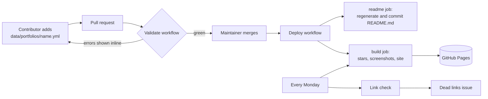

# Maintaining

How the list works, the one-time setup, and what to do when something breaks.

## How it works

Everything is generated from the files in [`data/`](../data). Contributors never edit `README.md`.



| Workflow | When | What it does |
| --- | --- | --- |
| [`validate.yml`](../.github/workflows/validate.yml) | Every pull request | Unit tests; validates every data file (schema, file names, duplicates); for the files the PR changes, checks that the site responds and the repository exists; rejects hand edits of `README.md`; builds the site. Problems are reported as annotations on the exact line. |
| [`deploy.yml`](../.github/workflows/deploy.yml) | Push to `master`, Mondays, manual | Regenerates `README.md` and commits it as `github-actions[bot]`. Fetches GitHub stars and languages, takes screenshots of new, changed or week-old sites (cached between runs), builds the gallery and deploys it to Pages. |
| [`links.yml`](../.github/workflows/links.yml) | Mondays, manual | Checks every link in `README.md` with lychee. Opens or updates one "Dead links report" issue, and closes it when everything works again. |

Commits pushed by `github-actions[bot]` with the default `GITHUB_TOKEN` do not trigger workflows, so the README commit never causes a loop.

### Repository layout

| Path | Purpose |
| --- | --- |
| `data/portfolios/*.yml` | One file per portfolio. The only thing most contributors touch. |
| `data/tools.yml`, `data/articles.yml` | The Tools and Articles sections. |
| `schema/` | JSON schemas for the data files. Used by the validator and by editors for autocompletion. |
| `templates/README.md` | The README text around the generated lists. Placeholders look like `{{count}}`. |
| `awesome.config.json` | Title, tagline, site URL, repository and default branch, shared by the README and the site. |
| `scripts/` | Node.js scripts behind the `npm run` commands. `scripts/lib/` holds the shared code. |
| `site/` | The gallery: page templates (`site/templates/`), CSS, JavaScript and favicon (`site/assets/`). No framework, no build step beyond `npm run build:site`. |
| `tests/` | Unit tests (`npm test`, Node's built-in test runner). |
| `.cache/`, `dist/` | Generated, git-ignored. |

## One-time setup

1. **Turn on GitHub Pages.** *Settings → Pages → Build and deployment → Source:* **GitHub Actions**.
2. **Let the bot commit the README.** The `readme` job pushes to `master`. If `master` is protected by a ruleset or branch protection rule, add **GitHub Actions** to its bypass list. If you can't, the job fails but the site still deploys; you can then regenerate the README with `npm run readme` in a pull request.
3. **Require the checks** (recommended). In the ruleset or branch protection for `master`, require the **Check data** status check so a broken entry can't be merged.
4. **Polish the repository page** (optional). *About → Website:* the gallery URL. *Topics:* `awesome`, `awesome-list`, `github-pages`, `portfolio`, `portfolio-template`.
5. **Run the first deploy.** *Actions → Deploy → Run workflow.* The first run screenshots every site and takes a few minutes; the following ones reuse the cache.

## Everyday tasks

- **Review a new entry:** the checks are green, the site loads, it is a real portfolio hosted on GitHub Pages. Merge. Nothing else to do.
- **Change the README's wording:** edit `templates/README.md`, then run `npm run readme` (or let CI do it after merge).
- **Change the title, tagline or site URL:** edit `awesome.config.json`.
- **Retake every screenshot:** *Actions → Deploy → Run workflow* and tick *Retake every screenshot*.
- **Remove a dead entry:** delete its file in `data/portfolios/`. The weekly dead links report tells you which ones are broken.
- **Rename the default branch:** update `branch` in `awesome.config.json` and `on.push.branches` in `deploy.yml`.

## Troubleshooting

| Symptom | Fix |
| --- | --- |
| Deploy fails on *configure-pages* or *deploy-pages* | Pages is off or its source is not *GitHub Actions* (setup step 1). |
| `readme` job fails with a protected branch error | Setup step 2. |
| A screenshot shows a loader or a cookie banner | Run `npm run previews -- --only <slug>` locally to reproduce; adjust `SETTLE_MS` in `scripts/capture-previews.mjs` if many sites need longer. |
| Stars or languages missing | The GitHub API failed or rate-limited the run. Previous values are kept; the next run fills them in. |
| A contributor's check says the site is unreachable but it works | Some hosts block bots. HTTP 401, 403, 429 and 503 are only warnings; re-run the check, or merge if you verified the site yourself. |

## Local development

```sh
npm install
npm test
npm run validate -- --online   # needs network access to every site
npx playwright install chromium
npm run metadata && npm run previews
npm run dev                    # http://localhost:4173
```

Set `GITHUB_TOKEN` before `npm run metadata` to avoid the 60 requests per hour limit for anonymous API calls. Use `CHROMIUM_PATH` to point `npm run previews` at an existing Chrome or Chromium binary instead of downloading one.
